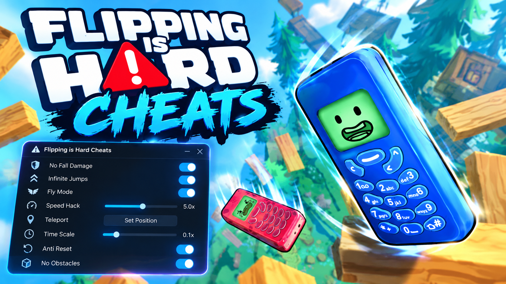

# Flipping is Hard — Cheats

**Keep your height after a fall, anchor mid-climb, rotation assist, teleport between all ten areas, 16-player co-op rescue.**

    

> **[⬇️ Download the latest Flipping is Hard cheats](../../releases/latest)**

    

[Settings](#the-settings) · [Which one do I need](#which-setting-fixes-which-problem) · [Questions](#questions)

---

> [!IMPORTANT]
> **Try Chill Mode first.** Elegant Horse Studios already shipped an easier mode with checkpoints, built into the game, tuned by the people who made it. If your problem is "I keep losing an hour to one bad rotation," that mode solves it properly and nothing here will do it better.
>
> This menu is for the things Chill Mode does not cover: rotation assists for players who physically struggle with the input, co-op rescue, area teleports on a replay, and physics sliders for messing about.

## What this is

Flippy is a legless flip phone trying to reach a boy named Jeff, and rotation is the only movement you get. You tip, you torque, you vibration-jump, and sometimes you watch twenty minutes of vertical progress unwind in four seconds. It is in the *Getting Over It* lineage and it is honest about it — the falling is not a failure state, it is the content.

Which makes a cheat menu for it a slightly absurd object, and the README says so rather than pretending otherwise. What is actually defensible in here: the **rotation assists**, because rotation-only control is hard on a trackpad and harder with a tremor; **co-op rescue**, because watching a friend fall past you with no way to help is the one frustration the game did not intend; and **area teleports**, for a second run when you already earned the climb.

## The settings

<strong>Flippy</strong> — the phone itself

| Setting | Key | Effect |
|---|---|---|
| Keep your height after a fall | <kbd>F1</kbd> | You still fall; you snap back to your highest point |
| Anchor in place | <kbd>F2</kbd> | Freeze mid-climb, let go when ready |
| Save / load position | <kbd>F3</kbd> / <kbd>⇧F3</kbd> | A manual checkpoint anywhere |
| Rotation assist | slider | `comfort` — torque smoothing, `0%`–`100%` |
| Snap to angle | — | `comfort` — rounds rotation to clean increments |
| Vibration jump power | slider | `0.5x`–`5x` |
| Infinite vibration | <kbd>F5</kbd> | No cooldown between jumps |
| Surface grip | slider | `1x`–`10x` — stop sliding off ledges |
| Flippy's mass | slider | `0.3x`–`3x` |

<strong>Physics</strong> — the sandbox half

| Setting | Key | Effect |
|---|---|---|
| Gravity | slider | `0.1x`–`3x` |
| Bounciness | slider | `0x`–`5x` |
| Friction | slider | `0x`–`5x` |
| Air control | — | Steering mid-fall, which the base game denies you |
| Slow motion | <kbd>F8</kbd> | Toggle, with a `0.1x`–`1x` speed slider |
| Time scale | slider | `0.25x`–`3x` |
| Noclip and fly | <kbd>F12</kbd> | `crew` |

<strong>The climb</strong> — ten areas, sixteen side quests

| Setting | Key | Effect |
|---|---|---|
| Teleport to any area | <kbd>F7</kbd> | All ten, no re-climb |
| Unlock all areas | — | `save` |
| Reveal collectibles and quest items | <kbd>F9</kbd> | Radius `20`–`300 m` |
| Complete side quests instantly | — | `save` — all sixteen |
| Highlight safe ledges | — | `comfort` — marks what you can actually rest on |
| Unlock all cosmetics and charms | — | `save` |
| Disable hazards | — | For a given area only |

<strong>Co-op</strong> — up to sixteen phones

| Setting | Key | Effect |
|---|---|---|
| Rescue a falling friend | <kbd>F6</kbd> | `crew` — catch them mid-drop |
| Teleport to friend | — | `crew` |
| Pull a friend to your height | — | `crew` |
| See teammates through terrain | — | Client-side |
| Friends cannot knock you off | — | Client-side |
| Lobby size | slider | `crew`, `2`–`16` |

Rescue is the one worth having. Everything else in here changes somebody else's climb, and they may have been enjoying the fall.

<strong>Display and menu</strong>

Camera pull-back to see the whole tower, field of view `60`–`120 deg`, free camera <kbd>F10</kbd>, hide interface <kbd>F11</kbd>, disable screen shake, high-contrast ledge outlines, screenshot mode. Plus leaderboard submission blocking, achievement blocking, host-only mode, rolling save backup, rebindable menu key and overlay opacity.

## Which setting fixes which problem

| What is actually going wrong | What to turn on | What stays intact |
|---|---|---|
| "I lose an hour to one slip" | Chill Mode, in the game's own options | Everything — use this first |
| "Rotation control hurts my hand" | Rotation assist 60%, snap to angle | Every route and every jump is still yours |
| "I'm on a trackpad and it's unplayable" | Rotation assist 80%, surface grip 3x | Same as above |
| "My friend fell and I could do nothing" | Rescue a falling friend | Your own climb |
| "I've beaten it, now I want the collectibles" | Teleport to any area, reveal collectibles | Nothing — you already earned the climb |
| "I just want to throw a phone around" | Gravity 0.3x, bounciness 4x, air control | Not a climb any more, and that is the point |
| "I want it harder" | Gravity 1.8x, surface grip 0.4x | Everything, unfortunately |

## Questions

Is using this going to get my account flagged?

There is no anti-cheat here and no competitive mode to police. The one shared surface is Steam Leaderboards, and submission is switched off by default whenever the menu is attached — a climb that used a manual checkpoint has no business sitting next to a clean run.

Why does this recommend the game's own Chill Mode?

Because it is better at the job. The developers built checkpointing into the game deliberately and tuned where those checkpoints sit. A third-party save-position hotkey is a blunter instrument and it will occasionally drop you somewhere the level was not expecting.

Are the rotation assists cheating?

They change how precisely your hand has to move, not where Flippy can go. Route choice, timing, reading a ledge and committing to a jump are all untouched. If rotation-only input is painful or impossible for you at full sensitivity, this is the difference between playing and not.

Can I use it in co-op without annoying everyone?

Rescue, see-through-terrain and the camera options affect nobody but you or help somebody else. Anything marked <code>crew</code> rewrites the shared session and is blocked while you are a guest. In a sixteen-player lobby, assume at least one person is there specifically to suffer.

Mac, Linux or Steam Deck?

The game runs on all three. This does not — it reads Windows process memory and nothing else. Proton and the native Mac build lay things out differently.

Half the settings went dead after a patch.

Memory addresses shift when the game updates, and they break one at a time rather than all together. Match your game build against the one named in the release notes, or flip on read-only mode to see which values the menu can still read.

My security software ate the download.

Peeking into another program's running memory looks, to a heuristic scanner, exactly like what a stealer does. Flagging is routine for this entire category of tool. Checksums ship with every release and the source is here to read. Adding an exclusion is your decision, and not adding one is a perfectly defensible position.

## If it misbehaves

- **<kbd>Insert</kbd> does nothing** — another overlay claimed it. Steam, Discord and RTSS are the usual suspects. Rebind it.
- **Menu cannot see the game** — start Flipping is Hard and get into an area first; there is no process to attach to on the launcher.
- **Co-op settings greyed out** — you are a guest and host-only mode is doing its job.
- **Loaded a position and clipped into geometry** — manual checkpoints do not validate the landing spot. Use Chill Mode's real checkpoints for anything you care about.
- **Physics sliders made the climb unwinnable** — reset to `1x` and adjust in small steps. Gravity and friction interact badly at extremes.
- **Unlocks gone after an update** — a persistent write got invalidated. Restore a backup from before the patch.

Filing something? [Open an issue](../../issues) with the **game build number** first, then Windows version, the area you were in, and the one setting that broke.

## Version history

**1.0.0** — 18 October 2026 — first build. 35+ settings across Flippy, Physics, The climb, Co-op and Display. Leaderboard submission and host-only mode both on by default.

---

Unofficial fan tool, no connection to Elegant Horse Studios, Dawn Wood Games or Valve. Flipping is Hard and its assets belong to them. Poking at a live process can crash it or corrupt a save — keep backups. MIT licence.

